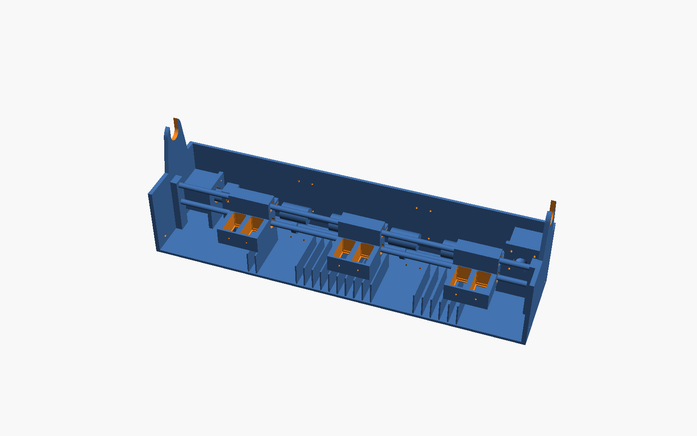

# Printable parts (v0, untested)

Our own parametric OpenSCAD design, **not** Open Tools' files: theirs are unpublished
(and will be CC BY-NC-SA 4.0 when they are). The layout follows what their photos and
assembly video show: a U-tray chassis, two 8 mm rods, a front-loading carriage for two
HP 63/302 cartridges, a GT2 belt, and a second NEMA17 driving a feed shaft through a
beam coupler. Geometry and dimensions are ours.

Frame printed in PETG per the build plan (theirs is folded sheet metal + an acrylic
front). Everything fits a Prusa CORE One (250 × 220 × 270) with no supports.



## What has and hasn't been checked

- **Checked:** every STL is watertight and fits the bed (trimesh). The assembly
  interference checks pass for the carriage at park, mid and far-right against the
  frame, motors, pulley/idler, feed + pinch rollers, coupler, belt and paper plane
  (`assembly.scad`, all six `check=` modes render empty).
- **Not checked:** nothing has been printed or assembled. HP cartridge dimensions are
  estimates. **Print `cart_fit_gauge` first** and adjust `cart_w`/`cart_d` in
  `common.scad`. Clearances are tuned for a 0.4 mm nozzle.
- **Not designed yet:** cartridge contact flex (harvest from an HP DeskJet carriage or
  use a YTEC/Magic Brush-style board), the felt park/spit pad, the front cover (acrylic or
  printed), display bezel, endstop, cable chain/FFC guide, cutter, wall-mount wire.
- Body is 537 × 130 × 105 mm (theirs ~497 × 111). It's longer and deeper so both motors
  and the coupler clear the carriage travel. Tightening this is the next iteration.

## Parts

| STL | Qty | Material | Notes |
|---|---|---|---|
| `cart_fit_gauge` | 1 | any | print first: test-fit both cartridges |
| `frame_left` | 1 | PETG | end wall, rod bosses, carriage-motor plate + shelf, shaft pillar, roll arm |
| `frame_mid` | 1 | PETG | floor, back wall, platen ribs |
| `frame_right` | 1 | PETG | end wall, idler box, feed-motor plate, shaft pillar, roll arm |
| `splice_floor` | 2 | PETG | one per joint, M3 × 12 + nuts |
| `splice_back` | 2 | PETG | one per joint, M3 × 12 + nuts |
| `carriage` | 1 | PETG/ASA | 2× LM8UU pressed in the lower bore; slot rides the upper rod |
| `roll_hub` | 2 | PETG | 2" core default (`core_id`), M3 grub + nut |
| `feed_sleeve` | 4 | **TPU 95A** | friction fit on the feed shaft; sleeve compliance = pinch force |
| `pinch_spacer_0..4` | 1 each | PETG | locate the 608 pinch bearings: 56.5 / 68 / 81 / 67 / 69.5 mm |
| `pi_zero_mount` | 1 | PETG | Pi Zero W, M2.5 self-tap |
| `encoder_knob` | 1 | PETG | EC11 D-shaft |

Print settings: PETG, 0.2 mm layers, 4 perimeters, 25 % gyroid. Frame sections print
upright as modelled (largest: 181 × 130 × 172 mm). Solid volume is ~1,050 cm³; at these settings expect
roughly 0.6–0.8 kg of PETG (check in your slicer).

## Bought parts

| Part | Qty | Notes |
|---|---|---|
| 8 mm steel rod, 533 mm | 2 | carriage rods (sockets are 14 mm deep each end) |
| 8 mm steel rod, ~419 mm | 1 | feed shaft (left pillar to ~12 mm into the coupler) |
| 8 mm steel rod, 386 mm | 1 | pinch shaft (through both pillars, press fit) |
| 8 mm steel rod, ~540 mm | 1 | roll spindle |
| LM8UU | 2 | carriage |
| 608 bearing | 6 | 4 pinch rollers + 2 roll spindle ends |
| NEMA17, **≤ 38 mm body** (e.g. 17HS3401) | 2 | carriage + feed. A 40/48 mm body hits the back wall |
| GT2 20T pulley, 5 mm bore | 1 | carriage motor, hub facing the carriage |
| GT2 20T toothed idler, 5 mm bore + M5 × 30 | 1 | right end |
| GT2 6 mm belt | ~0.9 m | both ends clamp into the carriage |
| Beam coupler 5 → 8 mm | 1 | feed motor to feed shaft |
| EC11 encoder, Pi Zero W, 1.47" ST7789 TFT, stepper drivers, cartridge driver board | | electronics TBD |
| M3 screws/nuts, M4 for wall/feet | | |
| HP 63/302/803 black + colour | 1 each | |

## Rebuilding

```sh
nix shell nixpkgs#openscad --command ./render.sh          # all STLs -> stl/
nix shell nixpkgs#openscad --command openscad -D 'check="frame_vs_carriage"' -o /tmp/c.stl scad/assembly.scad
```

All dimensions live in `scad/common.scad`. Change rods, cartridge size, paper zone or
travel there, re-render, and re-run the six `assembly.scad` checks.
